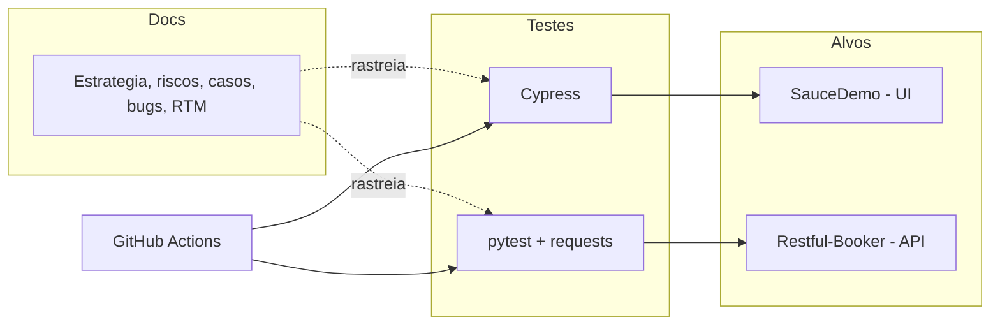

# Software Quality Portfolio

[](https://github.com/Nosferatu0-alt/software-quality-portfolio/actions/workflows/cypress.yml)
[](https://github.com/Nosferatu0-alt/software-quality-portfolio/actions/workflows/api-tests.yml)

Portfólio de **Qualidade de Software (QA)** de Lucia Maria Reis Braga, graduanda em Inteligência Artificial. Aqui pratico o raciocínio de teste de ponta a ponta: planejar, priorizar por risco, documentar, automatizar e reportar defeitos.

>  Sugestões e críticas são bem-vindas: abra uma *issue* ou *pull request*.

> 🚧 **Projeto em construção.** Este portfólio está sendo desenvolvido aos poucos: alguns documentos ainda têm lembretes e itens a preencher, e o [Roadmap](#roadmap) mostra o que já foi feito e o que vem a seguir.

## O que este projeto demonstra
| Habilidade | Onde ver |
|---|---|
| Planejamento e priorização por risco | [`docs/test-strategy.md`](docs/test-strategy.md), [`docs/risk-matrix.md`](docs/risk-matrix.md) |
| Casos de teste e rastreabilidade | [`docs/test-cases/`](docs/test-cases/), [`docs/traceability-matrix.md`](docs/traceability-matrix.md) |
| Reporte de defeitos | [`docs/bug-reports/`](docs/bug-reports/) |
| Teste exploratório | [`docs/exploratory/`](docs/exploratory/) |
| Automação de UI (Cypress, data-driven, comandos customizados) | [`cypress-saucedemo/`](cypress-saucedemo/) |
| Testes de API (pytest, JSON Schema, dados em CSV, limpeza de dados) | [`api/pytest-requests/`](api/pytest-requests/) |
| CI/CD com GitHub Actions | [`.github/workflows/`](.github/workflows/) |
| Decisões técnicas justificadas | [`docs/decisions/`](docs/decisions/) |

## Arquitetura


## Como rodar
```bash
make install-ui && make test-ui     # Cypress (SauceDemo)
make install-api && make test-api   # pytest (Restful-Booker)
```
Sem `make`: veja o README de cada pasta.

**Notas de ambiente:** Node.js 18+ para o Cypress; Python 3.10+ para a API. Os alvos são sites públicos de demonstração de terceiros e podem mudar ou ficar fora do ar, e os testes de API usam credenciais públicas de demonstração.

## Stack
Cypress 15 · Node.js · Python · pytest · requests · jsonschema · GitHub Actions · Mermaid

## Bugs identificados
| ID | Onde | Resumo | Severidade |
|---|---|---|---|
| [BUG-001](docs/bug-reports/BUG-001-problem-user-detalhe-produto-errado.md) | UI (SauceDemo) | `problem_user` abre detalhe de produto errado | Alta |
| [BUG-002](docs/bug-reports/BUG-002-auth-credenciais-invalidas-retorna-200.md) | API (Restful-Booker) | `POST /auth` responde 200 para credenciais inválidas | Média |
| [BUG-003](docs/bug-reports/BUG-003-delete-booking-retorna-201.md) | API (Restful-Booker) | `DELETE /booking/{id}` responde 201 Created | Baixa |

Os bugs de API estão cobertos por testes `xfail` (strict), marcados com `known_bug`: se o serviço for corrigido, a suíte avisa. Lista completa e modelo de relatório em [`docs/bug-reports/`](docs/bug-reports/).

## Roadmap
- [x] Cypress E2E (comandos customizados, fixtures, data-driven) + CI
- [x] Estratégia, plano, riscos, rastreabilidade, casos e template de bug
- [x] Estrutura de testes de API (pytest) + CI
- [x] Executar a suíte de API, confirmar comportamentos e registrar bugs reais
- [ ] Coleção Postman + Newman na CI
- [ ] Selenium + pytest com Page Object Model (ADR-002)
- [ ] Relatórios publicados (Allure / GitHub Pages)
- [ ] SQL: integridade e análise de performance
- [ ] BDD com Gherkin
- [ ] Plano de teste mobile (conexão instável em pagamento)
- [ ] Experimento de IA aplicada a testes

## Referências de estudo
Ver [`docs/estudo-portfolios-referencia.md`](docs/estudo-portfolios-referencia.md).
